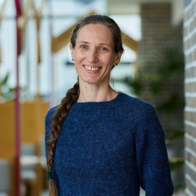

{ .cc-head }

Share<a class="cc-share cc-share--li" href="https://www.linkedin.com/sharing/share-offsite/?url=https%3A%2F%2Fcloudcon.au%2Fabstracts%2F2026%2FTatianaSelezneva%2F" target="_blank" rel="noopener" aria-label="Share on LinkedIn">in</a><a class="cc-share cc-share--x" href="https://twitter.com/intent/tweet?url=https%3A%2F%2Fcloudcon.au%2Fabstracts%2F2026%2FTatianaSelezneva%2F&amp;text=How%20Kubernetes%20Gets%20Released%3A%20A%20Contributor%E2%80%99s%20View%20from%20the%20Release%20Team%20%E2%80%94%20Tatiana%20Selezneva%20at%20CloudCon%20Sydney%202026" target="_blank" rel="noopener" aria-label="Share on X">X</a><a class="cc-share cc-share--fb" href="https://www.facebook.com/sharer/sharer.php?u=https%3A%2F%2Fcloudcon.au%2Fabstracts%2F2026%2FTatianaSelezneva%2F" target="_blank" rel="noopener" aria-label="Share on Facebook">f</a>

# How Kubernetes Gets Released: A Contributor’s View from the Release Team

**Tatiana Selezneva** &middot; Engineering Manager, REA Group

*Full length talk (20 minutes)*

## Abstract

We all know how difficult it is to meet deadlines. And yet this large, global, distributed open source community keeps shipping on time. How does it work?

In this talk, I'll share what I learned from working on the Kubernetes Release Team in the Release Signal subteam. I'll walk through how a Kubernetes release moves from planning to shipping, how the Release Signal team helps to understand readiness and risk, and how many different contributors work together to keep releases moving.

If you use Kubernetes and want to better understand the community behind it, or if you have ever wondered how to start contributing in a meaningful way, this talk will give you a clearer picture of the release process and the paths available to make an impact.

## Speaker Bio

Tatiana is a part of the Platform Engineering team at REA Group, where she focuses on improving developer productivity through the use of Kubernetes orchestration and cloud-native technologies. She is passionate about streamlining development processes and enabling innovation within the tech community.

---

[&larr; All speakers](../../speakers.md)
