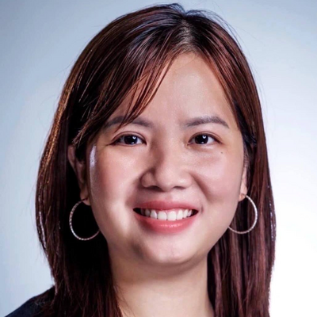

{ .cc-head }

Share<a class="cc-share cc-share--li" href="https://www.linkedin.com/sharing/share-offsite/?url=https%3A%2F%2Fcloudcon.au%2Fabstracts%2F2026%2FWendyHa%2F" target="_blank" rel="noopener" aria-label="Share on LinkedIn">in</a><a class="cc-share cc-share--x" href="https://twitter.com/intent/tweet?url=https%3A%2F%2Fcloudcon.au%2Fabstracts%2F2026%2FWendyHa%2F&amp;text=Becoming%20a%20CNCF%20Contributor%20with%201%20Hour%20a%20Week%20%E2%80%94%20Wendy%20Ha%20at%20CloudCon%20Sydney%202026" target="_blank" rel="noopener" aria-label="Share on X">X</a><a class="cc-share cc-share--fb" href="https://www.facebook.com/sharer/sharer.php?u=https%3A%2F%2Fcloudcon.au%2Fabstracts%2F2026%2FWendyHa%2F" target="_blank" rel="noopener" aria-label="Share on Facebook">f</a>

# Becoming a CNCF Contributor with 1 Hour a Week

**Wendy Ha** &middot; Software Engineer, SEEK

*Lightning Talk (5 mins)*

## Abstract

AI is making it easier than ever for anyone to write code, but open source still needs more people willing to help. The biggest challenge today isn’t about technical skills, it’s finding the time to contribute without turning it into another after-hours commitment.

The CNCF ecosystem has more than 200 projects and countless ways to get involved. As a Kubernetes contributor and contributor to CNCF TAG DevEx, I’ll share a practical approach to help everyone to getting started, even with just one hour a week, less time than you might spend scrolling social media.

In this lightning talk, you’ll learn how to:

- Find your home among 255 CNCF projects.
- Choose where to contribute based on your skills, interests, and available time.
- Find approachable issues and turn your first contribution into a meaningful PR.
- Use AI effectively without creating AI slop or adding extra work for maintainers.
- Build a sustainable contribution journey that eventually can grow your career.

The goal isn’t to spending more time to contribute, you just need to start!

## Speaker Bio

Wendy is a CNCF Ambassador and a proud advocator for Women in the Cloud Native community. She is also an open source contributor and has contributed to various aspects of Kubernetes, including SIG Release (serving on the Release Team since v1.31), SIG Node and SIG Etcd. She has taken on leadership roles as the Release Signal Lead for Kubernetes v1.33 and Release Lead Shadow for v1.34, where she focuses on improving release processes and mentoring new contributors into the open source space.

---

[&larr; All speakers](../../speakers.md)
